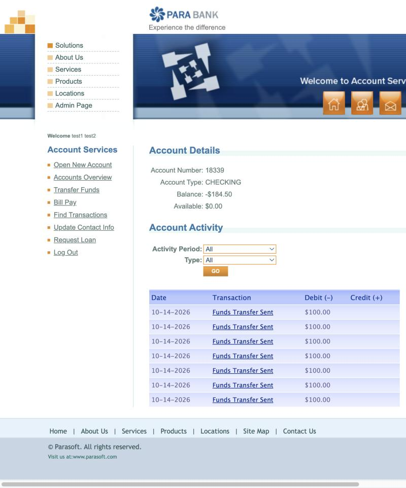
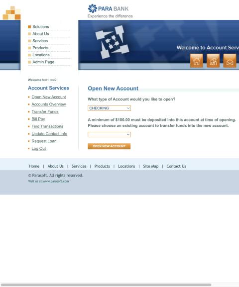
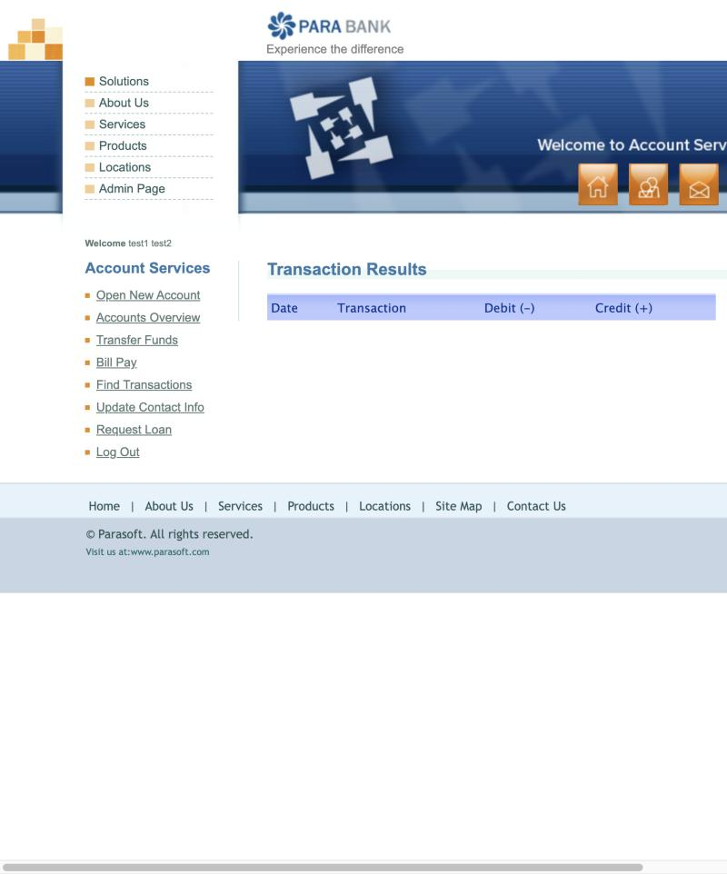

# Task 2: Exploratory Testing & Bug Reports (ParaBank)

## How I explored

| Where I looked | Why |
|---|---|
| Accounts Overview and Account Activity first | In a bank, the numbers must add up. I checked that balances, the total and the history agree with each other. |
| Open New Account, as a form that moves money | Anything that moves money must stop when there isn't enough. I checked whether that rule is enforced. |
| Find Transactions, every search type | I searched for transactions I knew existed, using each search type, to see if they all find the same data. |
| The server replies behind each page | To confirm the screen shows what the server actually holds. |

**Not covered:** Transfer Funds, Bill Pay, Request Loan and Update Contact Info. The shared demo data was reset during my session, which wiped my test user. After that, every page showed "An internal error has occurred" (see evidence `Env_site_error_after_demo_data_reset.jpg`).

---

## BUG-01 · Opening a new account takes the $100 deposit from an account with no money, pushing it below zero

| Field | Details |
|---|---|
| Environment | ParaBank public demo (parabank.parasoft.com/parabank), Chromium browser on macOS, 14 Oct 2026 |
| Preconditions | A newly registered user, logged in. Their first account (18339 in my run) starts at $515.50. |
| Severity | High: money leaves an account that has none, with no warning and no limit. |
| Priority | High: any customer can push their account below zero just by opening accounts, which is unapproved lending for the bank. |

**Steps to reproduce**
1. Register a new user and log in.
2. On Accounts Overview, note the first account's balance ($515.50).
3. Click **Open New Account**. Choose **SAVINGS**, choose the first account as the source, and click **Open New Account**.
4. Repeat step 3 four more times. The first account now has $15.50.
5. Repeat step 3 once more.

**Actual vs expected**

| | |
|---|---|
| Actual | The new account opens anyway. The first account drops to -$84.50 and shows Available $0.00. No warning. |
| Actual (continued) | The overdrawn account is still offered as a source, so it keeps going. In my run it reached -$184.50 after 7 new accounts. |
| Expected | The account isn't opened, and a message says there isn't enough money in the source account. |
| Where the expectation comes from | 1. The page says the $100.00 minimum is moved from an existing account, so that account must have it. |
| | 2. The app itself shows Available $0.00, so it knows there's nothing to move. |
| | 3. A basic banking rule: you can't move money you don't have unless an overdraft has been agreed. |

**Evidence** (folder `evidence/`)

| File | What it shows |
|---|---|
| `Bug1_01_account_18339_activity_balance_-184.50.jpg` | Account 18339: balance -$184.50, available $0.00, seven "Funds Transfer Sent" of $100.00 |
| `Bug1_02_open_new_account_page_min_100_rule.jpg` | The Open New Account page and its $100.00 minimum rule |
| `Bug1_03_api_accounts_and_transactions.json` | Server replies: the balances, the 7 debits, and 18339 still offered as a source |
| The numbers | $515.50 − 7 × $100.00 = −$184.50. The overview total stayed at $515.50. |

**Also noticed:** the history of account 18339 shows only the seven $100.00 debits. It doesn't show the opening $515.50, so the history doesn't add up to the balance.

---

## BUG-02 · Find Transactions "by Amount" finds nothing, even when the account has transactions of that amount

| Field | Details |
|---|---|
| Environment | ParaBank public demo (parabank.parasoft.com/parabank), Chromium browser on macOS, 14 Oct 2026 |
| Preconditions | A logged-in user whose account has at least one $100.00 transaction. Opening a new account creates one. |
| Severity | Medium: the search gives a wrong, empty answer. No money is lost, and the full list on Account Activity is a workaround. |
| Priority | Medium: a customer checking a payment by amount will think it never happened, then call support or pay again. |

**Steps to reproduce**
1. Register a new user and log in.
2. Click **Open New Account**, choose any type, use the first account as the source, and confirm. This takes $100.00 from the first account.
3. Go to **Accounts Overview** and click the first account. Account Activity shows "Funds Transfer Sent $100.00".
4. Go to **Find Transactions** and select the first account.
5. In **Find by Amount**, type `100` and click **Find Transactions**.

**Actual vs expected**

| | |
|---|---|
| Actual | "Transaction Results" shows an empty table, with no "no results" message. |
| Actual (server) | The page calls `GET /parabank/services_proxy/bank/accounts/18339/transactions/amount/100`, which returns `200` with `[]`. Using `100.00` gives the same result. |
| Expected | The $100.00 transactions are listed. In my run, that's seven of them. |
| Where the expectation comes from | 1. Account Activity for the same account lists seven $100.00 transactions. |
| | 2. On the same page, Find by Transaction ID `21913` returns one of them, so the data exists and can be searched. |
| | 3. The field is labelled "Find by Amount". |

**Evidence** (folder `evidence/`)

| File | What it shows |
|---|---|
| `Bug2_01_find_transactions_account_18339.jpg` | The search page with account 18339 selected |
| `Bug2_02_find_by_amount_100_empty_result.jpg` | The empty result after searching for 100 |
| `Bug2_03_find_by_id_21913_works.jpg` | Find by ID on the same account returns the $100.00 transaction |
| `Bug2_04_api_find_by_amount.json` | The request the page sent, the empty reply, and the IDs of the $100.00 transactions that should have been found |

**Also noticed:** searching by date (10-14-2026) also returned `[]` from the server. I didn't confirm this through the screen before the data reset.

---

## Screenshots

**BUG-01: account 18339 at -$184.50, with Available $0.00 and seven $100.00 transfers out** 

**BUG-01: the Open New Account page says the $100.00 minimum comes from an existing account** 

**BUG-02: Find by Amount = 100 on account 18339 returns an empty table** 

**BUG-02: Find by Transaction ID 21913 on the same account finds the $100.00 transaction** 

**Environment: every page errored after the shared demo data was reset** 

